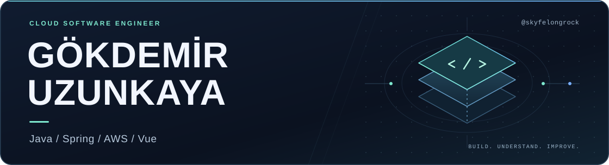

  

<h1 align="center">Cloud software, from API to UI.</h1>

  <strong>Cloud Software Engineer</strong> · Backend &amp; Full-Stack · Türkiye

  <a href="https://www.linkedin.com/in/gokdemiruzunkaya/"><strong>LinkedIn ↗</strong></a>
  &nbsp; · &nbsp;
  <a href="mailto:gokdemir.uzunkaya@gmail.com"><strong>Email ↗</strong></a>
  &nbsp; · &nbsp;
  <a href="https://github.com/skyfelongrock?tab=repositories"><strong>Explore my code ↗</strong></a>

  <!-- Historical baseline: 509 Komarev profile views observed on 2026-10-20; extraCount preserves this total after migration. -->
  

---

## About me

I'm **Gökdemir Uzunkaya**, a software engineer working across **Java & Spring**, **AWS**, and **Vue.js**. I build backend services and the interfaces that make them useful, with a focus on clear behavior, maintainable code, and practical problem solving.

I enjoy following a feature through the whole system: from the API and data model to the interface, tests, and logs that explain what happens in production.

## What I work on

- **Backend & APIs** — Spring Boot services, REST integrations, and communication between microservices.
- **Cloud & delivery** — AWS, CI/CD workflows, containers, and visibility into running systems.
- **Web interfaces** — Vue.js features, dashboards, and data visualizations.
- **Quality & debugging** — Automated tests, log analysis, and tracing behavior across service boundaries.

## Tools I work with

| Area | Technologies |
| :--- | :--- |
| **Backend** | Java · Spring Boot · REST APIs |
| **Cloud** | AWS Lambda · S3 · EC2 · CloudFormation · CloudWatch |
| **Frontend** | JavaScript · Vue.js · HTML · CSS · D3.js |
| **Data** | SQL · PostgreSQL · MySQL · Redis |
| **Build & automation** | Python · Docker · Jenkins · Maven · Git · Linux |
| **Testing** | JUnit · Mockito · Vitest · Postman |

## How I approach engineering

**Understand the behavior. Keep the solution clear. Verify the result.**

I like changes that solve a concrete problem, are easy to review, and leave the next person with code they can understand. Good tests and useful diagnostics are part of that work.

## GitHub activity

  
   
  GitHub calendar contributions · Last 365 / 30 calendar days · Updated automatically every 6 hours
   
  Private activity is included only when returned by GitHub; the image states the verified access scope. Counts are not all commits or hours worked.
   
  <a href="./docs/contribution-activity.md">Data coverage, privacy &amp; verification</a> · A failed refresh keeps the previous timestamped snapshot.

## Explore my GitHub

Browse my [public repositories](https://github.com/skyfelongrock?tab=repositories) for code, experiments, and projects I follow.

<strong>Earlier Java &amp; Spring projects · 2022</strong>

These learning projects are part of my Java and Spring foundations:

| Project | Focus |
| :--- | :--- |
| [RegisterLogin](https://github.com/skyfelongrock/RegisterLogin) | Authentication with Spring Security and JWT, relational persistence, and service communication with Retrofit. |
| [Blog](https://github.com/skyfelongrock/Blog) | A Spring Boot blog service with REST endpoints, Thymeleaf views, and MySQL. |
| [Daily](https://github.com/skyfelongrock/Daily) | A Spring Boot CRUD service with JPA, H2, and OpenAPI documentation. |
| [SOLID examples](https://github.com/skyfelongrock/solid-examples) | Small Java examples exploring the five SOLID design principles. |

---

  Interested in cloud, backend, or full-stack engineering? <a href="mailto:gokdemir.uzunkaya@gmail.com"><strong>Let's connect.</strong></a>
   
  <a href="https://www.linkedin.com/in/gokdemiruzunkaya/">LinkedIn</a> · <a href="https://www.instagram.com/gokdemiruzunkaya/">Instagram</a> · <a href="https://github.com/skyfelongrock?tab=overview">GitHub activity</a>

